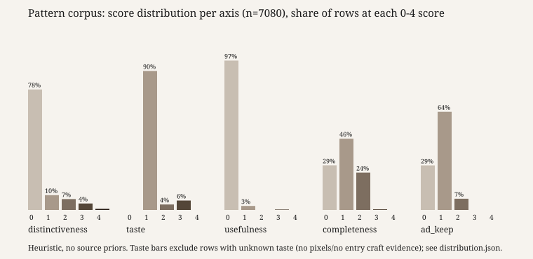

# CONTENT-AUDIT: Design MCP pattern corpus

Lane: Claude Opus 5.5, session `419b2a67`, 2026-11-20. Baseline commit `82fe6e3`. **Read-only audit.** The approved rollout removed all audited rows from the default tool surface and kept the pinned snapshot available through explicit compatibility modes. [Rollout plan](PLAN.md#11-rollout-after-slice-g)
Token use: exact usage was not observable in this session, so no figure is reported. After the owner's steering the follow-up was capped at about 7k more tokens, with no additional agents.

## 0. Verdict

Every row is too weak to ship as written: **0 of 7,080 pattern rows survive as-is**; rev 2 removes the source and ID priors from scoring. 470 rows are candidates for rewrite from source. The action list identifies 6,285 cull candidates and records why, with 277 further candidates conditional on recovering their assets.

The rollout preflight matched all 7,080 dispositions to the pinned historical snapshot and both source copies. The nine curated direction IDs are distinct from every audited legacy ID. The package already excludes the bulk legacy snapshot from its wheel. The rollout plan gates the broader change to default retrieval on the repair comparison. [Preflight and file hashes](evidence/content/rollout-preflight.json) · [Rollout gate](PLAN.md#11-rollout-after-slice-g)

The rollout starts the three curated tools without reading legacy data. With `DESIGN_MCP_SURFACE=both`, all 17 smoke calls returned identical structured results before and after the change at each of two fixed Python hash seeds. The package preserves the pinned legacy bytes and excludes three offline preprocessing files from the wheel. The combined web and desktop review candidate passed 411 source tests and all eight fresh-install jobs on macOS 15. [Candidate and parity receipts](evidence/content/curated-default-candidate.json)

- **The library homogenises.** Across 7,080 rows there are only **14 unique `behavioral_description` strings**. One of them, the AI hero ("Large headline with subtext and primary CTA… hover glow… staggered fade-in"), appears on **5,823 rows (82%)**. **5,665 rows (80%)** point to token set 3, whose primary is `#6366f1` indigo. So the corpus does more than miss distinctiveness: it assigns banned tells to award-winning sites.
- **A strong source in the reviewed sample has generic metadata.** I fetched and viewed the asset for `awwwards-studio-dado`. The real page sets a serif display line, "FORM FOLLOWS FEELING", full-bleed over warm interior photography on an offset grid. Its DB row gives the AI-hero text above and the indigo token set. `awwwards-voku-studiotm` has no headline and no CTA, yet the DB says it has both. See `evidence/content/judged_sample.md` rows 21 and 22.
- **Placeholder references survive in tool responses.** In packaged data, 6,555 layout notes and 6,954 component code values are references. The search and condensed-blueprint path attempts to resolve them, leaving 91 layout and 2,494 component occurrences unresolved across the corpus. The detailed path resolves token and decision-tree indices only. [Runtime resolution receipt](evidence/runtime/template-resolution.json)
- **Junk is labelled as design.** 2,038 crawled rows are error, blocked or directory pages: 1,375 are named "404 Not Found", 208 are "您未被授权查看该页" ("you are not authorized to view this page"), and there are Cloudflare challenge pages and "Index of /…" listings. 6,036 rows are typed "Landing Page".
- **The assets are absent from the current checkout.** 742 rows reference `screenshots/**`. At `5f2f990` the tree held 742 LFS pointers (`git lfs ls-files 5f2f990` lists 742). Commit `0526905` ("Make screenshots optional") deleted them, so HEAD holds only `screenshots/README.md`, whose `git lfs pull` instruction no longer works there. Whether the remote LFS store still has the blobs is **unverified**: fetching them would be a ~600 MB bulk download, which this audit didn't run. 31 rows carry a remote image URL and two assets were confirmed viewable in this audit.

## 1. Scope and inputs (every record was read programmatically)

| File (runtime `design_mcp/data/` = mirror `data/`, SHA-256 identical) | Records | Scored as |
|---|---|---|
| patterns.json | 7,080 | one pattern row each |
| tokens/token_sets.json, tokens/semantic_tokens.json | 141 + 2 | one token set each |
| behavioral_templates.json | 27 | one page template each |
| component_code.json, layout_templates.json | 17 + 1 | one component or layout each |
| anti_generic_system.json | 33 (sections, 5 profiles, 15 anti-patterns, 6 component strings) | one record each |
| visual_recipes.json, anti_pattern_fixes.json | 9 + 10 | one record each |
| decision_trees.json, decision_trees_indexed.json, taxonomy.json, libraries.json | 4 + 4 + 5 + 18 | one record each |
| vision_results.json | 742 | not scored separately: all 742 keys match pattern rows and 733 entries match all fields. Nine differ in UI-element lists. [Field reconciliation](evidence/content/vision-reconciliation.json) |
| remaining_vision.json, batch_list.json | 173 + 728 | not scored: build work-queue stubs (`id/name/image_url`) with no content |

Mirror and alias rule: every action applies to **both** `design_mcp/data/<file>` (the runtime copy read by `server.py`) and `data/<file>` (the byte-identical root mirror). `action_list.csv` lists both paths on every row. The per-file hashes are in `distribution.json › inputs`.

Book, documentation, and prompt dispositions are recorded in the [reference-material audit](evidence/content/REFERENCE-MATERIAL.md).

## 2. Rubric, rev 2 (0–4 per axis; `evidence/content/score_content.py`)

The independent script review found two biases, and both are now removed from every score and disposition. The first was a source prior, which ranked rows by their provenance (curated/awwwards above dribbble/landbook above crawl). The second was a bonus for hand-written `seed-*` IDs. The source rank survives only as `source_prior_rank_comparison_only`, a column no score or action reads.

| Axis | Evidence used (entry-specific unless noted) |
|---|---|
| Distinctiveness | how many rows share its description (1 → 4, ≤10 → 3, ≤100 → 2, ≤1,000 → 1, more → 0); +1 for extracted colours; +1 for style tags; −1 if its token set is shared by more than 1,000 rows |
| Taste | **craft evidence without pixels**: concrete layout values, extracted palette, UX patterns, and a description that is entry-specific and concrete, minus **the row's own** banned tells. Tells inherited from shared template text or a shared token set are recorded as context (`inherited-tells`) and not charged to the entry. With no craft evidence, taste is **unknown** (`taste_basis` is `unknown-no-pixels` when an asset exists but wasn't viewed) |
| Usefulness | +1 each for: real layout notes, UX patterns, colours, a **local asset that is actually present**, a hint with **non-empty, non-placeholder code**, a description shared by 10 or fewer rows. Remote URLs are labelled `remote-unverified` and not counted |
| Completeness | 12 fields, with placeholders counted as empty |
| AD keep | capped at 2: no heuristic promotion to launch-ready |

Disposition, the same for every source:
1. Junk title with no asset → cull.
2. Duplicate among asset-backed rows → merge.
3. Opaque hash name, no viewable asset and no craft evidence → cull-unless-blob-recovered.
4. Any asset reference → rewrite-from-source.
5. No asset and craft evidence ≥2 → **keep-as-reference**.
6. No asset and craft evidence of 1 → rewrite.
7. Anything else → cull.

The schema has no type-pairing, scale-ratio, motion or why fields, so **no row can be launch-ready**. Every row's `reasons` lists `missing-direction-fields`. Supplemental records get a `missing_direction` column, and none of the 271 has all six required fields.

## 3. Distribution (7,080 pattern rows, rev 2)



| Score | unknown | 0 | 1 | 2 | 3 | 4 |
|---|---|---|---|---|---|---|
| Distinctiveness | – | 5,543 | 681 | 501 | 300 | 55 |
| Taste (craft evidence) | **6,885** | 0 | 176 | 7 | 12 | 0 |
| Usefulness | – | 6,871 | 187 | 0 | 21 | 1 |
| Completeness | – | 2,050 | 3,279 | 1,719 | 32 | 0 |
| AD keep (cap 2) | – | 2,046 | 4,516 | 518 | – | – |

Taste is unknown for 6,885 rows (97%). 600 of those reference assets that couldn't be viewed (742 local-absent, 31 remote-unverified, 6,307 with no asset). Only 195 rows have entry-level text evidence. Source: `distribution.json › distribution`, `taste_basis`, `asset_state`.

## 4. Row-level action list (rev 2)

The full list is **`evidence/content/action_list.csv`**, 7,351 rows, with columns `heuristic_action`, `final_action`, `reasons`, `runtime_path` and `mirror_path`.

| Action | Rows | By source (descriptive only; the source isn't used in any rule) |
|---|---|---|
| cull | 6,285 | 6,134 crawl; 151 dribbble rows with a page URL only, no image and no craft evidence (`page-url-only-recapture-possible`) |
| cull-unless-blob-recovered | 277 | dribbble rows with hex-id names |
| merge-duplicate | 26 | awwwards |
| rewrite-from-source | 470 | 305 awwwards, 90 landbook, 68 curated, 7 dribbble |
| keep-as-reference | 22 | the `seed-*` rows, now reached through craft evidence rather than an ID bonus. They are text references with brand-copy palettes (see §6) and are **not** launch-ready |
| keep (launch-ready) | **0** | |

The `source_prior_vs_action_comparison_only` table in `distribution.json` shows actions now line up with the former rank only through the evidence each row carries.

Supplemental (271 records): rewrite 240, **keep-as-reference 29** (18 libraries plus 11 former heuristic "keeps"), cull 1 (`component_code.HeroSection`), fix 1 (`color_overrides`: `#zinc-*` values).

## 5. Strongest and worst actual examples

**Strongest (worth rebuilding around)**
1. `awwwards-studio-dado`: the asset was viewed, so taste is grounded in pixels for this row only. Serif display over full-bleed photography, offset grid, a small sans for UI. Merge it into `screenshot-awwwards-9ec90cffbc` and rewrite.
2. `anti_generic_system.json › composition_rules` and `elevation_system`: specific and non-default (a hero KPI then 3 secondaries, never equal width; 2–3% lightness steps). They are **dark-dashboard only**, so keep them scoped to that.
3. `behavioral_templates.json › Dashboard`: `text-[2.5rem] tracking-[-0.03em]`, "NEVER equal width". It is the only one of the 27 page templates that scores keep.

**Worst**
1. `component_code.json › HeroSection`: `mx-auto max-w-2xl text-center`, "Your headline here", "A compelling subheadline…". This is the banned AI hero shipped as reference code.
2. `patterns.json` description shared by 5,823 rows: it encodes the AI hero, the hover glow and the staggered fade-in.
3. `anti_generic_system.json › font_system.root_css`: `* { font-family: 'Inter', system-ui }`. The anti-generic system mandates the banned font globally, and 4 of the 5 aesthetic profiles do the same.
4. `webui7k-*` named "404 Not Found" (1,375 rows), all typed "Landing Page".

## 6. Sampled judgments vs heuristic

`evidence/content/judged_sample.md` covers 22 pattern rows (a seeded stratified draw plus 2 viewed assets) and 13 supplemental records, all read by one model, **not independent human taste**. It was written against the rev-1 scorer. In that sample every disagreement found the heuristic too lenient, and rev 2 removes the leniency the sample exposed: seed rows are no longer kept, and remote URLs no longer count as present. A separate GPT-6.2 Sol review sampled 17 rev-2 pattern dispositions and five supplemental records across the action categories and checked all 26 merge pairings. It supported the dispositions for triage and added checks for synthetic reference labels and merge provenance. [Independent rev-2 sample](evidence/content/REV2-SAMPLE.md)

## 7. Limits

- Assets: 742 local blobs are absent. Only 2 of the 31 remote assets were fetched and viewed (SHA-256 `37d012d4…c351d` Dado, `18a23823…e003` Voku). Downloads stay in `.context/` (untracked) because the images are third-party.
- No source site was re-crawled. "Rewrite-from-source" (470 rows) and "cull-unless-blob-recovered" (277) depend on recovering the blobs through the `5f2f990` LFS pointers or the public pages. That is untested: the pointers are verified, the blobs are not. Any row whose blob can't be recovered falls to cull.
- The source audit records the search for “Tyre” and the decisions on other reference material. [Source material audit](evidence/content/REFERENCE-MATERIAL.md)
- Taste is scored from entry text and metadata. Visual taste was judged on 2 assets only.
- Supplemental reference candidates are scoped examples. The two supplemental references drawn in the independent sample were read in full. The remaining candidates still need review before any reuse. [Independent rev-2 sample](evidence/content/REV2-SAMPLE.md)

## 8. Reproduce

```bash
python3 -I evidence/content/score_content.py          # writes CSVs, distribution.json/.svg (deterministic: two runs, identical SHA-256)
```
File list and hashes: `evidence/content/MANIFEST.md`.
